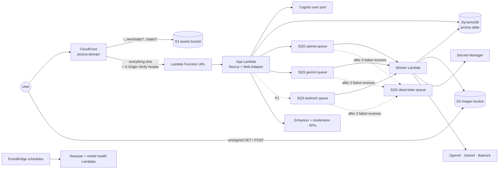
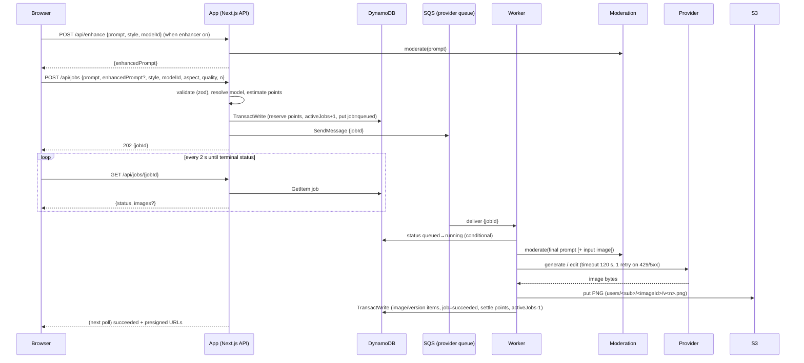
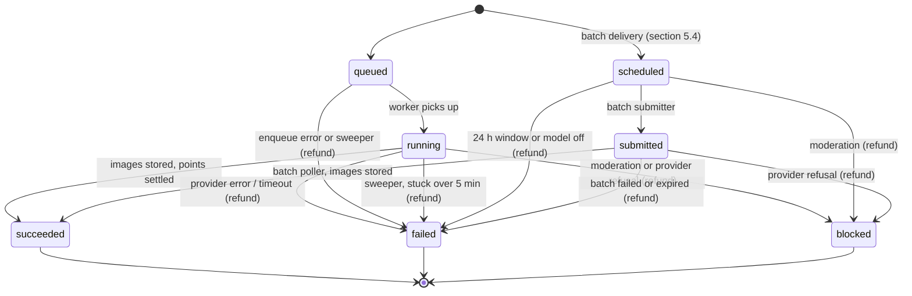

# Pictora Technical Design

Oct 8, 2026 · Rakesh Pillai · Status: Draft v0.1 · Based on the [PRD](prd.md)

This document describes how Pictora is built: components, data model, job pipeline, provider integration, security and testing. CI/CD is covered separately in [cicd_design.md](cicd_design.md). Requirement IDs (GEN-1, ADM-5, …) refer to the PRD.

## 1. Summary of decisions

| Area | Decision |
| --- | --- |
| Region | `us-west-2` for everything; ACM certificate for CloudFront in `us-east-1` |
| Accounts and environments | One AWS account for both environments (accepted; see the risks in the CI/CD design), referenced as a GitHub variable and never committed. Two environments, `dev` and `prod`, as separate CDK stacks |
| CPU architecture | arm64 (Graviton) for all Lambdas: about 20% cheaper; images are built natively on GitHub's free arm64 runners (public repo) |
| Repository | Monorepo with npm workspaces: `app/`, `worker/`, `packages/core`, `packages/providers`, `infra/`, `e2e/` |
| Language and runtime | TypeScript everywhere, Node.js 22 LTS |
| Web app | Next.js (App Router, `output: 'standalone'`) in a container on Lambda with the AWS Lambda Web Adapter, behind CloudFront |
| Background work | SQS queue per provider and a worker Lambda (container image) |
| Data | DynamoDB single table, on demand; S3 for images |
| Auth | Amazon Cognito user pool (Google + email/password), managed login, OAuth code flow with PKCE, httpOnly cookies |
| Secrets and config | Secrets Manager for provider keys; model registry in DynamoDB, seeded from a JSON file in the repo |
| Image delivery | S3 presigned GET URLs (15 min); uploads via S3 presigned POST |
| Infrastructure as code | AWS CDK v2 (TypeScript) |
| Observability | Powertools for AWS Lambda (TypeScript) logs and metrics, CloudWatch dashboard and alarms, AWS Budgets |
| Testing | Vitest (unit), React Testing Library (components), CDK assertions (infra), Playwright (end to end against dev with a mock provider) |

Images use S3 presigned URLs rather than CloudFront signed URLs. They need no CloudFront key pair to manage, and edge caching adds little for private images seen by one user.

## 2. Repository layout

```
pictora/
├── app/                    Next.js web app (UI + API route handlers)
│   ├── src/app/            App Router pages and /api routes
│   ├── src/lib/            auth, db, s3, rate limits, API helpers, cn() (utils.ts)
│   ├── src/components/     screens and shared components; ui/ holds the shadcn/ui components (section 3.3)
│   ├── src/hooks/          React hooks shared by components (use_mobile.ts)
│   ├── components.json     shadcn/ui settings (style, aliases, base colour)
│   ├── content/legal/      terms, content policy and privacy policy in Markdown
│   ├── public/static/      landing page sample images (served from the assets bucket)
│   └── Dockerfile          standalone build + Lambda Web Adapter
├── worker/                 Lambda handlers (container image)
│   ├── src/generate.ts     SQS consumer: moderate → generate/edit → store → settle
│   ├── src/sweeper.ts      scheduled: fail and refund stuck jobs
│   ├── src/model_health.ts scheduled: check registry models still exist
│   └── Dockerfile
├── packages/
│   ├── core/               shared types, zod schemas, registry types, points maths, size mapping
│   │   └── models.json     model registry seed (source of truth for model config)
│   └── providers/          provider adapters (OpenAI, Gemini, Bedrock, Mock), enhancer, moderation
├── infra/                  CDK app (stacks, constructs, tests)
├── e2e/                    Playwright tests
├── docs/                   PRD, tech design, CI/CD design
└── package.json            npm workspaces root
```

Files use `snake_case`, and classes and React components use `PascalCase`.

## 3. Runtime architecture



### 3.1 Web app on Lambda

- **Build:** `next build` with `output: 'standalone'`. The Docker image copies `.next/standalone` and runs `node server.js` on port 3000. The Lambda Web Adapter extension is copied into `/opt/extensions/`.
- **Adapter settings:** `AWS_LWA_PORT=3000`, `AWS_LWA_READINESS_CHECK_PATH=/api/health`, `AWS_LWA_INVOKE_MODE=response_stream`. The Function URL invoke mode is `RESPONSE_STREAM`.
- **Lambda settings:** arm64, 1024 MB, 30 s timeout, reserved concurrency 20 in prod (cost guard).
- **Static assets:** `.next/static` and `public/static/` are uploaded to an S3 assets bucket by CDK `BucketDeployment`, from the files inside the app image (`infra/scripts/extract_app_static.sh`), so they match the server exactly. CloudFront serves them through Origin Access Control with a long cache time. Next.js hashes the file names, so no invalidation is needed. Other files in `public/` are served by the app. The Next.js image optimizer is off (`images.unoptimized`), so `next/image` points straight at these files. On Lambda the optimizer would fetch them through the app's own handler, and the proxy's origin check would reject that internal request.
- **Function URL protection:** the URL uses auth type `NONE`. CloudFront adds a secret `X-Origin-Verify` header, and the Next.js proxy (`app/src/proxy.ts`; Next.js 16 renamed the middleware file convention to proxy) rejects requests without it (403). The secret lives in Secrets Manager and is rotated by redeploying.
  Why not Origin Access Control for Lambda: with it, POST bodies need a client-computed `x-amz-content-sha256` header, which browsers don't send.
- **CloudFront:** the default behaviour uses `CachingDisabled` and the `AllViewerExceptHostHeader` origin request policy. A Function URL rejects a forwarded `Host` header.

### 3.2 Worker

- Container image Lambda on arm64 (needed for `sharp`, which has a native binary), 1536 MB, 180 s timeout. One image (`worker/Dockerfile`, on the AWS Lambda Node.js 22 base image) holds every handler as a bundled `<name>.mjs`; each function picks its handler with the image command, for example `generate.handler`.
- One SQS queue per provider (`openai`, `gemini`, and `bedrock` in P1), each with its own event source mapping. The dev-only `mock` provider has no queue of its own: its jobs go through the `openai` queue. The app gets the queue URLs as `<PROVIDER>_QUEUE_URL` environment variables and may only send to them. Batch size 1, `ReportBatchItemFailures`, and `maximumConcurrency` 5 per queue (set in config) to stay inside provider rate limits.
- Visibility timeout 1,080 s (6 × the function timeout, as AWS recommends). `maxReceiveCount` 3, then the dead-letter queue, which has an alarm.
- Scheduled functions, triggered by EventBridge:
  - `sweeper` (every 5 min): marks jobs stuck in `running` for over 5 min, or in `queued` for over 10 min, as `failed`, refunds points, and frees the concurrency slot. It finds them through the active-jobs index (section 4), and each refund is conditional on the job still being in the status it was found in.
  - `model_health` (daily, 06:00 UTC): checks every enabled registry model against its provider's models list: OpenAI's models list, the Gemini models list (same `@google/genai` backend as the adapter), and Bedrock `ListFoundationModels` for Stability AI (`bedrock:ListFoundationModels`). A model that is missing, marked legacy by Bedrock, or retiring within 60 days (the registry's `eolDate` or Bedrock's end of life) is logged by name and counted in `ModelHealthProblems`; the model health alarm emails the admin, which covers the model-retirement risk in the PRD. A provider whose list can't be read is logged and skipped, never flagged.
- `batch_submit` and `batch_poll` (each every 15 min): the batch submitter and poller for batch mode (section 5.4), 1536 MB, 600 s timeout.
- `success_metrics` (daily, 00:30 UTC): computes the success metrics summaries (section 11.1) for the 8 days before today. A failed run is retried once; a rerun gives the same summaries.
- Account purge (AUTH-3): `purge` in the same image, fed by the `purge` queue (batch size 1, dead-letter queue after 3 receives). `DELETE /api/me` sends it `{ sub, username }`. It deletes every item under `USER#<sub>` (the profile last), every object under `users/<sub>/` and `uploads/<sub>/`, then the Cognito user; each step skips what is already gone, so a retry is safe. While the profile still has `activeJobs`, it puts the message back with a 60 s delay, up to 10 times, so a finishing job doesn't write images back after the purge.

### 3.3 UI and styling

- **Stack:** Tailwind CSS v4 (through `@tailwindcss/postcss`, `app/postcss.config.mjs`) and shadcn/ui (new-york style, base colour neutral, `lucide-react` icons). `app/components.json` holds the shadcn settings; the `@/*` import alias points at `app/src`.
- **Rules for UI code:** style with Tailwind utilities and shadcn/ui components only. No other CSS, no `style=` props, no new classes in `globals.css`. Build screens from the components in `app/src/components/ui/`, which are shadcn's sources adapted to this repo (snake_case file names such as `dropdown_menu.tsx`, and fixes for the repo's lint rules), and join classes with `cn()` from `app/src/lib/utils.ts`. To add a shadcn component, add its source the same way: rename the file to snake_case and fix its imports.
- **`globals.css`:** the Tailwind and shadcn setup comes first: the imports (`tailwindcss`, `tw-animate-css`), the `dark` custom variant, the `:root` and `.dark` tokens, and the `@theme inline` mapping. The old hand-written classes follow in the `legacy` cascade layer, which sits above Tailwind's preflight and below its utilities (`@layer theme, base, legacy, components, utilities`). They use `--legacy-*` colour variables with light and dark values, and the layer reverts preflight's resets to browser defaults for elements outside shadcn components (anything without `data-slot`; the sidebar shell's wrapper and inset don't count, since they hold the old screens), so the old screens look as they did. The redesign replaces them screen by screen and deletes the layer (#107 to #112).
- **Themes:** `next-themes` (`ThemeProvider` in the root layout, `attribute="class"`, `defaultTheme="system"`, `enableSystem`) puts `light` or `dark` on `<html>`, follows the OS live while the choice is System, and keeps the choice in local storage. Its inline script sets the class before the first paint (`suppressHydrationWarning` on `<html>`), carrying the CSP nonce from the `x-nonce` request header when the proxy sets one. `ThemeSwitcher` (a `DropdownMenu`: Light, Dark, System) sits in the site header on public pages and at the right edge of the page header (the inset header) on signed-in pages.
- **Layouts:** two route groups share the root layout (`<html>`, the theme provider, the toaster). `app/src/app/(site)/` holds the public pages (landing, legal pages, onboarding) under the site header and footer; the site header starts with the same Pictora icon and name as the sidebar (`PictoraIcon`), linking home. `app/src/app/(app)/` holds the signed-in pages (generate, edit, gallery, image detail, account, admin) inside the sidebar shell (`AppShell`, from shadcn's `SidebarProvider`, `Sidebar` and `SidebarInset`); route groups don't change URLs. The sidebar has the Pictora icon (`APP_ICON_PATH`, the 192 px app icon) and name; links to Generate, Gallery, Edit and, for the `admins` group, Admin, with the current page highlighted; the history of the user's 10 newest images (`GET /api/images?limit=10`); and a footer with today's points (`GET /api/me`) and, last, the user menu (email, Account, Sign out), which is the only link to the account page. The page header (the inset's, above every signed-in page) holds the sidebar trigger, the icon and name on mobile, and the theme switcher at its right edge. On desktop the sidebar is shadcn's `floating` variant (an inset, rounded, bordered panel with a shadow) and collapses to icons (the trigger, or Ctrl/Cmd+B); it starts collapsed, and the `sidebar_state` cookie keeps the user's choice after that (expanded only when the cookie is `true`). Below 768 px it opens as a `Sheet`. Screens that change the user's images or points (a finished generate or edit, an upload, a delete) call `notifyImagesChanged()` (`app/src/lib/images_changed.ts`), a window event on which the history and points load again.
- **Generate screen:** laid out like a chat (`GenerateScreen`). Each request made on this visit is a turn in the thread (`generate_turn.tsx`): the prompt with its options as chips, then that job's live status and results; each turn follows its own job, and the newest scrolls into view. Turns stay until the page is left; older images are in the sidebar history. With no turns yet, a greeting offers example prompts that fill the composer. The composer is pinned to the bottom of the window: an auto-growing prompt with its counter (Enter sends, Shift+Enter adds a line), the cost line and the send button, and an options row (`generate_controls.tsx`): the enhancer toggle, a style popover with the sample thumbnails, aspect ratio and quality selects (quality with points per image), the count from 1 to 4, transparent background, avoid and "Save points" where offered, and the model picker behind Advanced. The enhancer's editable output sits between the thread and the composer, so it never covers the thread.
- **Image screens:** the gallery is a responsive grid of `Card` thumbnails (two columns at 360 px, up to five), with `Skeleton` tiles while it loads, a `Badge` for the version count, running and scheduled jobs as placeholder cards at the top, an empty state, and a Load more button that infinite scroll also triggers. On wide screens a tile opens the detail view in a `Dialog`; narrow screens and direct links use its page. The dialog has a fixed height that fits the window (`min(100svh - 2rem, 52rem)`), centred, whatever the prompt's length: the detail fills it (`fill`), the picture takes the space left, and the settings card scrolls on a short window. On both the dialog and the page, long free text (the prompt, enhanced prompt, what to avoid and the edit instruction) sits in a shadcn `ScrollArea` (`ui/scroll_area.tsx`) capped at 8rem, which the keyboard can reach and scroll, so it never pushes the picture or the actions out of view (#145). The detail view (`image_detail.tsx`) shows the picture, the version carousel and a row of actions (Download, Rerun, Edit, Report, Delete) beside a `Card` of the version's settings; Delete asks first in an `AlertDialog`, which stays open while the delete runs and shows its error. Report (`report_image.tsx`) is a `Dialog` with a `RadioGroup` of reasons and a thank-you toast. The edit panel uses a `Textarea` for the instruction, `Select`s for the model and quality (the quality select is the generate screen's, with points per image), and the reference picker as a `Dialog` (`gallery_picker.tsx`); the upload step (`upload_image.tsx`) is a `Card` with a dashed drop zone and a `Progress` bar.
- **Image screens:** the gallery is a responsive grid of `Card` thumbnails (two columns at 360 px, up to five), with `Skeleton` tiles while it loads, a `Badge` for the version count, running and scheduled jobs as placeholder cards at the top, an empty state, and a Load more button that infinite scroll also triggers. On wide screens a tile opens the detail view in a `Dialog`; narrow screens and direct links use its page. The detail view (`image_detail.tsx`) shows the picture, the version carousel and a row of actions (Download, Rerun, Edit, Report, Delete) beside a `Card` of the version's settings; Delete asks first in an `AlertDialog`, which stays open while the delete runs and shows its error. Report (`report_image.tsx`) is a `Dialog` with a `RadioGroup` of reasons and a thank-you toast. The edit panel uses a `Textarea` for the instruction, `Select`s for the model and quality (the quality select is the generate screen's, with points per image), and the reference picker as a `Dialog` (`gallery_picker.tsx`); the upload step (`upload_image.tsx`) is a `Card` with a dashed drop zone and a `Progress` bar.
- **Account, onboarding and admin screens:** the account page (`account_details.tsx`) shows the profile and today's points in a `Card`, then a `Card` for deletion (`delete_account.tsx`) whose confirmation is an `AlertDialog`: Delete my account stays disabled until DELETE is typed exactly, and the dialog stays open while the request runs and shows its error. Onboarding (`onboarding_form.tsx`) stays outside the sidebar shell, as a centred `Card` with a `Checkbox` each for the age confirmation and the terms (with links to the terms and content policy); Continue checks both. The admin area (`admin/layout.tsx`, `admin_dashboard.tsx`, `success_metrics.tsx`, `spend_chart.tsx`, `moderation_review.tsx`, `admin_user.tsx`, with the shared pieces in `admin_parts.tsx`) shows its stats as `Card` tiles, its lists in `Table`s, which scroll sideways inside their container on narrow screens (the sidebar inset is `min-w-0`, so a wide table never widens the page), account and review statuses as `Badge`s, and moderation entries as `Card`s. Suspend and Unsuspend each ask first in an `AlertDialog`, which stays open while the change runs and shows its error. The spend chart takes its provider colours from the theme's chart tokens (`fill-chart-*`, `bg-chart-*`, `PROVIDER_COLOURS` in `admin_format.ts`), so it follows light and dark; success metrics show met targets in green and missed ones in `destructive`, always with the words too.
- **Toasts:** shadcn's `Sonner` `Toaster` is mounted once in the root layout and follows the theme; show toasts with `toast()` from `sonner`, including the "<Feature> coming soon" ones.

## 4. Data model (DynamoDB)

There is one table, `pictora-<env>`, on demand, with point-in-time recovery on in prod. Keys are `PK` and `SK` (strings), and one global secondary index, `GSI1` (`GSI1PK`, `GSI1SK`). Expiry uses the `ttl` attribute. IDs are ULIDs, so they sort by time.

| Entity | PK | SK | Key attributes | TTL |
| --- | --- | --- | --- | --- |
| User profile | `USER#<sub>` | `PROFILE` | email, createdAt, tosAcceptedAt, tosVersion (`TOS_VERSION` from `packages/core`), ageConfirmed, status (`active` \| `suspended` \| `deleting`), deletionRequestedAt, `dailyPoints` (optional override, ADM-5), activeJobs, cooldownUntil (ISO 8601 UTC), abuseFlag; success metric markers, each set once: signupCountedAt, firstSessionAt, returnedAt, firstImageShownAt | — |
| Daily usage | `USER#<sub>` | `USAGE#<yyyy-mm-dd>` | `used` (points reserved + spent), `GSI1PK=USAGE#<date>`, `GSI1SK=<used, zero-padded>` | 35 days |
| Rate window | `USER#<sub>` | `RATE#<yyyymmddHHMM>` | count | 2 min |
| Image | `USER#<sub>` | `IMG#<imageId>` | title (the start of the prompt, or `Uploaded image`), latestVersion, versionCount, versionsClaimed (the last version number an edit claimed, section 5.3), style, modelId, source (`upload` for an uploaded image), createdAt, thumbKey (the latest version's) | — |
| Image version | `USER#<sub>` | `VER#<imageId>#<n>` | s3Key, thumbKey, width, height, source (`upload` for an uploaded version 1), parentVersion, prompt, enhancedPrompt, avoid, sentPrompt (the prompt with style text, as sent to the provider), style, editInstruction, referenceCount, modelId, quality, aspect, seed, transparentBackground (what a rerun needs, GAL-3), jobId, costPoints, createdAt, downloadedAt (first download, section 11.1) | — |
| Block record | `USER#<sub>` | `BLOCK#<ulid>` | stage (`prompt` \| `image` \| `provider`), category, jobId (or uploadId for a blocked upload), createdAt | 24 h |
| Job | `JOB#<jobId>` | `META` | userId, type (`generate` \| `edit`), status, request (zod-validated JSON), modelId, provider, pointsReserved, usageDate (the `USAGE#` day the points came from, so a refund after midnight finds them), pointsCharged, providerCostCents, error (`{ code, message }`, the message in plain language, GEN-10), images (`[{ imageId, version, s3Key }]` once succeeded), createdAt, startedAt, finishedAt, attempts; for a batch job (section 5.4) submittedAt and batchId (the provider's batch). While `queued`, `running`, `scheduled` or `submitted`: `GSI1PK=JOBS#<status>`, `GSI1SK=<createdAt, startedAt or submittedAt>` (the active-jobs index), removed when the job finishes | 30 days |
| Model registry | `MODEL#<modelId>` | `CONFIG` | registry entry (section 6.1), `GSI1PK=REGISTRY`, `GSI1SK=<modelId>` | — |
| Platform spend | `PLATFORM` | `SPEND#<yyyy-mm>` | spentCents (provider cost of every job that reached the provider, including failed ones), capCents (the configured cap, recorded by the worker) | — |
| Sign-up flag | `SIGNUP#<email in lower case>` | `ABUSE` | abuseFlag, createdAt; written by the pre-sign-up trigger, moved onto the profile when the app creates it | 30 days |
| Sign-up IP counter | `SIGNUPIP#<yyyy-mm-dd>` | `<sha-256 of the source IP, 32 hex>` | count | 2 days |
| Daily stats | `STATS#<yyyy-mm-dd>` | `MODEL#<modelId>` | images, points, providerCostCents, failures, blocks | 400 days |
| Moderation review stats | `STATS#<yyyy-mm-dd>` | `MODERATION` | blocksReviewed, falseBlocks (blocks reviewed `ok`, for the false-block metric), reportsReviewed; counted on the day of the entries reviewed (ADM-4) | 400 days |
| Enhancer stats | `STATS#<yyyy-mm-dd>` | `ENHANCER#<enhancer model>` | calls, inputTokens, outputTokens, costCents (overhead, never charged to users), fallbacks (output failed moderation), failures | 400 days |
| Success metric counters | `METRICS#<yyyy-mm-dd>` | `COUNTS` | signups, firstSessionGenerates, returnGenerates (these three on the sign-up day), jobsSucceeded, jobsFailed, jobsBlocked, imagesGenerated, imagesDownloaded, imagesDiscarded (on the day the image was made), firstImagesShown (section 11.1) | 400 days |
| Time to first image | `METRICS#<yyyy-mm-dd>` | `TTFI#<sub>` | ms (first page load to first image shown), on the day it was shown; one per user | 400 days |
| Active user | `METRICS#<yyyy-mm-dd>` | `ACTIVE#<sub>` | — (a job of the user's succeeded that day) | 400 days |
| Success metrics summary | `METRICS#<yyyy-mm-dd>` | `SUMMARY` | the seven PRD metrics, each with its numerator and denominator, and the day's time-to-first-image samples; written by the daily job | 400 days |
| Moderation log | `MODLOG#<yyyy-mm-dd>` | `<ulid>` | type (`block` \| `report` \| `admin_action`), userId, promptExcerpt (200 characters), modelId, createdAt. Blocks: stage, category, provider, jobId. Reports: reason, imageId, version, s3Key. Blocks and reports, once reviewed (ADM-4): review (`ok` \| `confirmed`), reviewedBy, reviewedAt. Admin actions: userId is the admin's sub, action (`suspend` \| `unsuspend` \| `review`), targetUserId, and for a review entryDate, entryId, verdict | 90 days |

**Access patterns**

| Pattern | Operation |
| --- | --- |
| Gallery, newest first (GAL-1) | Query `PK=USER#<sub>`, `SK begins_with IMG#`, descending, 24 to a page; the cursor is the last image's ID, sent back as `ExclusiveStartKey` |
| Gallery placeholders for running jobs (GEN-8) | Query GSI1 `GSI1PK=JOBS#queued`, `JOBS#running`, `JOBS#scheduled` and `JOBS#submitted`, filtered on `userId`; the index holds only unfinished jobs, so it stays small |
| Image detail + versions (GAL-2) | Query `PK=USER#<sub>`, `SK begins_with VER#<imageId>#` |
| Rerun settings (GAL-3) | GetItem `VER#<imageId>#1` |
| Delete an image (GAL-3) | Delete the S3 prefix `users/<sub>/<imageId>/`, then `IMG#<imageId>` and every `VER#<imageId>#` item in batches, then sweep the prefix again |
| Job status poll | GetItem `JOB#<jobId>`, checking that userId matches the caller |
| Today's usage | GetItem `USAGE#<today>` |
| Whole model registry (seed, loader) | Query GSI1 `GSI1PK=REGISTRY` |
| Top users by spend today (ADM-3) | Query GSI1 `GSI1PK=USAGE#<date>`, descending. The worker writes `GSI1SK` (10 digits) after each settle or refund |
| Stuck jobs (sweeper) | Query GSI1 `GSI1PK=JOBS#running`, `GSI1SK < now − 5 min`, and `GSI1PK=JOBS#queued`, `GSI1SK < now − 10 min` |
| Batch jobs (submitter, poller; section 5.4) | Query GSI1 `GSI1PK=JOBS#scheduled` and `GSI1PK=JOBS#submitted`, oldest first |
| Blocks in the last 24 h | Query `SK begins_with BLOCK#` (TTL plus a filter on createdAt) |
| Admin stats for a range (ADM-3) | Query `PK=STATS#<date>` for each day (at most 92), GetItem `PLATFORM/SPEND#<month>` |
| Moderation review queue (ADM-4) | Query `PK=MODLOG#<date>`, descending, filtered to blocks and reports |
| Success metrics for a range | BatchGetItem `METRICS#<date>/SUMMARY` for each day (at most 92) |
| Daily success metrics job | GetItem `METRICS#<date>/COUNTS`, Query `METRICS#<date>` with `SK begins_with TTFI#` and `ACTIVE#`, and Query `STATS#<date>`, for each day it needs |
| Account deletion (AUTH-3) | Query all items under `USER#<sub>` and delete them in batches; delete the S3 prefix `users/<sub>/` |

### 4.1 Points and limits

Points are integers, and 1 point is $0.01 of provider list price.

- **Estimate:** `points = model.qualities[quality].costPoints × count` (`estimatePoints` in `packages/core`). Each quality fixes the output size tier (Gemini `imageSize` 1K, 2K or 4K; OpenAI quality at 1024²), so its cost is the price of one image at that size; the aspect ratio doesn't change it.
- **Reserve** (in the create-job API), as one `TransactWriteItems` call:
  1. Update `USAGE#<today>`: `ADD used :p`, on condition `attribute_not_exists(used) OR used <= :limitMinusP`. The limit is `profile.dailyPoints ?? (profile.abuseFlag ? 5 : DEFAULT_DAILY_POINTS)` (25).
  2. Update `PROFILE`: `ADD activeJobs :1`, on condition `activeJobs < :2` and `status = active` and no cooldown in force (LIM-3).
  3. Put `JOB#<id>` with condition `attribute_not_exists(PK)`.
- **Settle** (worker, on success): the user pays the actual cost rounded up to points, capped at the returned images' share of the reservation, so a partial success (fewer images than requested) charges only for the images returned (`settleJobPoints`). If that is lower than the reservation, `ADD used :negativeDiff` on the job's `usageDate`. Then increment `PLATFORM/SPEND#<month>` and `STATS#…` by the actual cost, and decrement `activeJobs`.
- **Refund** (failure or block): `ADD used :-p` and decrement `activeJobs`, in the same transaction that sets the job's final status, and count the failure or block in `STATS#…`. If the provider had already answered (for example, storing the images failed), its cost is still added to the platform spend.
- **Rate limit:** 10 jobs a minute, via `ADD count :1` on `RATE#<minute>` with the condition `count < 10`, as a fourth item of the reserve transaction. A transaction cancelled by a concurrent one (`TransactionConflict`) is retried. Enhancer calls and upload requests take a slot in the same window. The `testers` group (the e2e test account) gets 50 a minute instead (`rateLimitPerMinute` in `packages/core`): one e2e run makes about 15 of these requests in parallel, mostly within one minute. Daily points and the 2-running-jobs cap are the same for testers.
- **Errors:** error answers are `{ error, code }`, where `error` is a plain-language message for the user (GEN-10).
- **Platform cap:** at job creation, a request for a quality other than `draft` reads `PLATFORM/SPEND#<month>`. If `spentCents` has reached the cap (`SPEND_CAP_CENTS` from `spendCapUsd` in config: $100 in prod, $20 in dev), it is refused with 403 `premium_paused` and the message "Premium models are paused until <1st of next month>…". `GET /api/models` and the generate page mark those qualities `paused`, and the UI disables them. After each job with a provider cost, the worker records the cap on the spend item and publishes the month's total as the `MonthlySpendCents` metric (Embedded Metric Format, namespace `Pictora/<env>`); alarms at 80% and 100% of the cap email the admin. A small overrun from jobs already in flight is accepted.
- The reset at 00:00 UTC comes for free, because the usage key is per day.

## 5. Job pipeline

### 5.1 Generate flow



If `SendMessage` fails after the reservation, the API marks the job `failed` and refunds in the same request.

### 5.2 Job states



**Idempotency:** the worker moves the job `queued → running` with a conditional update. If SQS redelivers a message whose job is already `running` or finished, the worker acknowledges it and does nothing. A job that died mid-flight is failed and refunded by the sweeper, never sent to the provider again. That rules out paying twice for one job.

**Retries:** the worker retries a provider call once, after 2 s with jitter, on HTTP 429, 5xx or a network error. It does not retry on 4xx or a safety refusal (GEN-10).

### 5.3 Edits (EDIT-1 to EDIT-5)

- An edit is a job of type `edit`: `{ imageId, parentVersion, instruction, modelId, quality, referenceKeys? }`. The model must support `edit` and the quality. An edit costs one image at that quality, reserved as for generation. The edit panel starts on Gemini 3.1 Flash Image (`DEFAULT_EDIT_MODEL_ID`), with GPT Image 2 and the other edit models as alternatives (EDIT-4).
- **References (EDIT-5):** up to 3 `referenceKeys`, no more than the model's `referenceImages`; the panel hides them for a model that takes none. A key is either an upload that is never completed, `uploads/<sub>/<ulid>` (the browser gets a presigned POST from `POST /api/uploads`, whose answer carries the `key`, and sends the file without calling `complete`, so it stays out of the gallery and expires with the 1-day lifecycle rule), or a version of one of the user's images, `users/<sub>/<imageId>/v<n>.png`. The panel's "Choose from gallery" lists the user's images and sends the picked image's latest version.
- **Checks at creation:** the parent `VER#` item, every referenced version, and every reference upload (present and at most 10 MB) must belong to the caller; anything else answers 404, so image IDs can't be probed.
- Edits are **stateless**: each one sends the parent version's PNG plus the instruction (and the references after it) to the provider. No provider chat history is kept, so edits are reproducible, provider-independent, and survive model changes. The aspect sent is the parent's own when the model offers it, otherwise the nearest one it does (`nearestAspect`), so an uploaded photo keeps its shape.
- **Worker:** loads the parent PNG and the references from S3 (a reference upload is decoded, turned upright and converted to PNG as an upload would be), moderates the instruction and each image, and calls `adapter.edit`. A parent or reference that has gone (deleted or expired) fails the job with `source_missing` and a full refund, before any provider call.
- The result is stored as the image's next version, with `parentVersion` and `editInstruction`. Earlier versions are never overwritten (EDIT-3). The number comes from a counter on the `IMG#` item (`versionsClaimed`, starting from `latestVersion`), claimed after the provider answers, so concurrent edits never write the same `v<n>.png`; a claimed number whose job then fails is left as a gap. The transaction that records the version adds 1 to `versionCount` and sets `latestVersion` and the image's `thumbKey`, unless a higher-numbered edit finished first. An image deleted while its edit ran fails the job with a refund.
- **Uploads (EDIT-2):** the `/edit` page checks the file's type and size, then asks `POST /api/uploads` for a presigned POST. Its conditions are the exact key, `content-length-range` 1 byte to 10 MB, the content type the browser asked for (JPEG, PNG or WebP), and a 5-minute expiry. The browser uploads straight to `uploads/<sub>/<ulid>`, then calls `POST /api/uploads/:id/complete`. The app checks the object exists and is at most 10 MB, decodes it with `sharp`, and moderates a 1024 px copy. A flagged upload is deleted and recorded as a block (`BLOCK#` with `uploadId`, and a `MODLOG#` entry), which counts towards the cooldown. An allowed one is turned upright, stripped of its metadata, scaled down to fit 4096 px, and stored as a PNG with a thumbnail: version 1 of a new image whose ID is the upload ID (`source: 'upload'`), so completing twice is safe. The upload object is then deleted. Uploads cost no points. Uploads that are never completed expire after 1 day (lifecycle rule).

### 5.4 Batch mode (P1)

A slower, half-price way to generate (PRD scope, P1 Batch mode), through the OpenAI and Gemini batch APIs, which charge 50% of list price and finish within 24 hours.

- **Request:** a generate request may carry `delivery: 'batch'` (default `standard`); edits are always standard. The model must have `capabilities.batch` in the registry (`BATCH_PROVIDERS`: OpenAI, Gemini, and Mock on dev; the registry check refuses it for Bedrock, which has no image batch API). Auto routing then picks among batch models, counting the halved price against the points left. The job reserves half the points, rounded up (`batchPoints`), on the day it was made, and keeps them reserved, counting against that day's allowance, until it finishes. It counts towards the rate limit (LIM-3) but takes no concurrency slot, since it can wait for hours; the reservation only checks the profile (active, no cooldown). It starts `scheduled` on `JOBS#scheduled` and is never sent to a queue.
- **Submitter** (`batch_submit`, every 15 min): queries `JOBS#scheduled`, oldest first, and groups the jobs by model, at most 200 per batch. Each job's final prompt is moderated first, as the worker would before a paid call: a flagged job is blocked and refunded, and a moderation outage leaves the job for the next run. Each job is then claimed `scheduled → submitted` (conditional, with `submittedAt` and `JOBS#submitted`) before the provider call, so no job is ever sent twice. The adapter's `submitBatch` sends the batch and returns its ID, which is stored on each job as `batchId`; if the call fails, the claimed jobs are refunded. A job still scheduled 24 hours after it was made, or whose model is switched off or takes no batches, is refunded.
  - **OpenAI:** a JSONL file of `/v1/images/generations` requests, one line per job (`custom_id` = job ID, `n` = count), uploaded with purpose `batch`, then a batch with a `24h` completion window.
  - **Gemini:** an inline batch (`batches.create`) with one request per image, keyed `<jobId>#<n>` in the request metadata, since each call makes one image. Only the Gemini API backend takes inline batches, so Vertex AI refuses batch jobs.
  - **Mock:** accepts any batch and finishes it on the first poll, so dev can run batch jobs without spend.
- **Poller** (`batch_poll`, every 15 min): queries `JOBS#submitted`, groups the jobs by `batchId`, and reads each batch once (`pollBatch`, retried once on a transient error). While a batch runs nothing changes. Once it is done (completed, partly succeeded, expired or cancelled), each job's images are stored and recorded exactly as the worker does (`storeImage`, `completeJob`), and the points are settled with `settleJobPoints`: only the images that came back are charged, at the batch price. A job with no images is refunded: blocked for a provider safety refusal, `batch_expired` when the batch ran out of time or has no result for it, failed otherwise. A failed batch refunds all its jobs. A batch still running 25 hours after its jobs were made (the window plus an hour's grace) refunds them, and so does a submitted job that never got a `batchId` within an hour (the submitter died between the provider call and recording it).
- **Idempotency:** every write is conditional on the job's status and `GSI1SK`, and finished jobs leave the index, so polling a batch again records nothing twice.
- **Deleted accounts:** a batch job's finishing transaction checks the profile instead of freeing a slot. When the account is gone or being deleted, the job item alone is marked failed, nothing is written under the user, and images already stored for it are deleted again.
- **UI:** the generate screen offers "Save points: deliver later" under More with an explanation, and the send button shows the halved cost ("Schedule · 3 points", described as "Uses 3 of your 20 points today (half of 6, delivered later)"). After scheduling, the job shows as Scheduled; the form stays open, and the job is checked once a minute while the page is open. "Notify me when they're ready" asks for the browser's notification permission and shows a notification when the job succeeds, while the page stays open (there is no push). The gallery shows batch jobs as Scheduled placeholders, checked once a minute while nothing else is running.

## 6. Model registry and provider adapters

### 6.1 Registry entry

```ts
// packages/core/src/registry.ts
export type Quality = 'draft' | 'standard' | 'high';
export type Aspect = '1:1' | '4:5' | '3:2' | '2:3' | '16:9' | '9:16';

export interface ModelConfig {
  id: string;                      // stable Pictora id, e.g. "gemini-flash"
  provider: 'openai' | 'gemini' | 'bedrock' | 'mock';
  providerModelId: string;         // e.g. "gemini-3.1-flash-image"
  displayName: string;
  strengths: string[];
  enabled: boolean;                // kill switch (ADM-2)
  environments: ('dev' | 'prod')[];// "mock" is dev-only
  capabilities: {
    generate: boolean;
    edit: boolean;
    transparentBackground: boolean;
    negativePrompt: boolean;
    seed: boolean;
    referenceImages: number;       // max references accepted
    aspects: Aspect[];
    batch?: boolean;               // takes batch jobs (section 5.4); false when absent
  };
  qualities: Partial<Record<Quality, { providerParams: Record<string, unknown>; costPoints: number }>>;
  defaultFor: string[];            // style preset ids
  eolDate?: string;                // ISO date, alert 60 days before (PRD risk table)
}
```

- `packages/core/models.json` is the source of truth. A CDK custom resource in the `Data` stack (`infra/lambda/registry_seed_handler.ts`) writes it to DynamoDB on every deploy, with an upsert that **keeps** the `enabled` field already in DynamoDB, so a kill switch flipped by hand survives deploys and rollbacks. New models take `enabled` from the seed. Models removed from the seed are marked `enabled: false`, never deleted.
- The app and the worker cache the registry in memory for 60 s, so a kill switch takes effect within 1 minute (ADM-2). The loader (`@pictora/core/registry-store`) filters by environment, and never offers a `mock` model in prod.
- The UI gets models only from `GET /api/models`, filtered by `enabled` and environment: display name, strengths, capabilities, point cost per quality, and the style presets with their suggested model. Provider settings stay on the server.

**Kill switch (ADM-2).** To switch a model off, set `enabled` to false on its registry item; it disappears from `/api/models` within 60 s and stays off after later deploys. Set it back to true to switch the model on again.

```sh
aws dynamodb update-item --region us-west-2 --table-name pictora-prod \
  --key '{"PK": {"S": "MODEL#gpt-image-2"}, "SK": {"S": "CONFIG"}}' \
  --update-expression 'SET enabled = :off' \
  --expression-attribute-values '{":off": {"BOOL": false}}'
```

### 6.2 Adapter interface

```ts
// packages/providers/src/types.ts
export interface ImageRequest {
  prompt: string;                  // final prompt (enhanced or raw)
  negativePrompt?: string;
  aspect: Aspect;
  quality: Quality;
  count: number;                   // 1–4
  seed?: number;
  transparentBackground?: boolean;
  inputImage?: Uint8Array;         // edits
  referenceImages?: Uint8Array[];
  signal: AbortSignal;             // 120 s timeout
}

export interface ImageResult {
  images: { png: Uint8Array; width: number; height: number; seed?: number }[];
  providerRequestId?: string;
  providerCostCents: number;       // computed from the provider's usage data when available
}

export interface ImageProvider {
  generate(model: ModelConfig, req: ImageRequest): Promise<ImageResult>;
  edit(model: ModelConfig, req: ImageRequest): Promise<ImageResult>;
}

// Batch mode (section 5.4): the OpenAI, Gemini and Mock adapters also implement this.
export interface BatchImageProvider {
  submitBatch(model: ModelConfig, items: BatchItem[], signal: AbortSignal): Promise<string>; // batch ID
  pollBatch(model: ModelConfig, batchId: string, items: BatchItem[], signal: AbortSignal): Promise<BatchPoll>;
}
// BatchItem = { key: jobId, request }; BatchPoll = pending | done (results by job ID, expired) | failed
```

The batch Lambdas get batch adapters from `createBatchProviderFactory`: errors come out typed, reading a batch is retried once, and submitting never is, since a retry after a lost answer could start a second batch.

Adapters throw typed errors (`ProviderSafetyError`, `ProviderRateLimitError`, `ProviderTimeoutError`, `ProviderError`), which the worker maps to job states. The worker gets adapters from `createProviderFactory`, which picks one by `ModelConfig.provider` and wraps it, so every call gets the one retry and anything an adapter or SDK throws comes out as one of the four typed errors. Every adapter returns PNG: if a provider sends another format, `sharp` converts it losslessly to PNG and leaves provenance metadata in place.

| Adapter | SDK | Generate | Edit | Notes |
| --- | --- | --- | --- | --- |
| OpenAI | `openai` | `images.generate` with `output_format: 'png'`, `quality`, `size`, `background` | `images.edit` with the parent image (+ references) | Sizes: 1024×1024, 1536×1024, 1024×1536; other aspects are generated at the nearest size and centre-cropped |
| Gemini | `@google/genai` | `models.generateContent` with an image response and an aspect-ratio config | Same call, with the parent image as inline data + the instruction | The same SDK works with the Gemini API (API key) or Vertex AI (`vertexai: true`), so moving to Vertex later would change only config. Pictora uses the Gemini API (section 16) |
| Bedrock (P1) | `@aws-sdk/client-bedrock-runtime` | `InvokeModel` in us-west-2 with Stability request bodies (`prompt`, `negative_prompt`, `aspect_ratio`, `seed`, `output_format: 'png'`; `mode: 'text-to-image'` for SD 3.5 Large). One image per call, so `count` images are parallel calls; when only some succeed, only those are returned and charged | Stability edit models through `us.` inference profiles (image tools, #35); Stable Image Core, SD 3.5 Large and Ultra generate only | IAM role auth; no key. All six aspects are native (about 1 megapixel). A content-filter `finish_reasons` entry becomes `ProviderSafetyError`. The worker may invoke only the Bedrock models listed in `models.json` |
| Mock (dev/test) | none | Returns a placeholder PNG at the mapped size showing the prompt, after a delay (`MOCK_PROVIDER_DELAY_MS`, default 1 s); `__fail__`, `__block__` and `__timeout__` in the prompt raise the matching error | Same, over the input image | Lets CI and end-to-end tests run with no provider spend. Reports the model's list price as its cost, so points behave as with a real provider |

### 6.3 Prompt enhancer and moderation

- **Enhancer (ENH-1 to ENH-4):** `POST /api/enhance` is synchronous, with a target of under 3 s (the call times out at 10 s). It answers 403 for the same account states as `POST /api/jobs` (`profileRefusal`), and counts in the same per-minute rate window. A system prompt tells the LLM to add subject, composition, lighting and style detail suited to the model, to keep the user's intent, and to add no people, brands or new content. The output is capped at 1,500 characters. The model is chosen in config (`ENHANCER_MODEL`, CDK context `environments.<env>.enhancerModel`): `bedrock:<id>` calls Bedrock `Converse` in us-west-2 with the app's IAM role (GPT-5.6 Luna is reached through the `us.openai.gpt-5.6-luna` inference profile), `gemini:<id>` calls the Gemini API with the key in `pictora/<env>/gemini`, and `mock` (dev, end-to-end tests) adds fixed detail with no call. So the GPT-5.6 Luna versus Gemini Flash test in M2 (`npm run compare:enhancers`) needs only a config change. The client is in `@pictora/providers/text`, which the app imports without `sharp`. Enhancer calls are not charged to users; their tokens and cost go to `STATS#<date>` / `ENHANCER#<model>`. If the enhancer or the input check fails, the API answers 503 `enhance_failed` and the screen generates from the user's words with a notice; if the output is flagged, or its check fails, the API answers with the user's words and `fallback: true` (ENH-4). The worker adds the style text to the enhanced prompt as it does to a raw one, so the enhancer is told the style but not to repeat it.
- **Moderation:** the OpenAI moderation endpoint (`omni-moderation-latest`) checks text and images. It runs on the raw prompt in `/api/enhance`, and in the worker on the final prompt and any input image (a 1024 px JPEG copy, which stays well inside the endpoint's request limit). A flag means the job is `blocked`, with a `BLOCK#` record and a `MODLOG#` entry. Three blocks in 24 hours set `cooldownUntil` to now + 24 h. A provider safety refusal is handled the same way (stage `provider`, category `provider_refusal`). If the moderation call fails, the job fails with a refund; it never goes ahead unchecked. The worker reads the OpenAI key from the secret named in `OPENAI_SECRET_ID`.
- **Policy mapping** (`BLOCKED_CATEGORIES` in `packages/core`): `sexual/minors`, `sexual`, `violence/graphic`, `hate/threatening`, `hate`, `harassment/threatening`, the three `self-harm` categories, `illicit/violent` and `illicit` block; the first one flagged, in that order, is logged. Plain `violence` and `harassment` are allowed, so a flag on those alone doesn't block. The user sees the neutral `blocked` message, never the category.
- **Reports:** `POST /api/reports` with `{ imageId, version, reason }` (reason one of `REPORT_REASONS`) writes a `MODLOG#` entry of type `report` for one of the user's own image versions (404 otherwise). The "Report" action sits in the image view.

### 6.4 Smart routing (Auto)

The generate screen's model picker starts on **Auto**, which picks the model from the style, quality, aspect, prompt and points left. The rules live in `packages/core` (`routeModel` in `routing.ts`) as tables in code, not as a model call, so they are cheap and predictable:

1. **Needs:** only models that generate (or edit, for an edit) and, when asked, make a transparent background. A prompt that asks for words in the image (quoted text, "that says", "lettering", "logo" and similar; `promptAsksForText`) tries the text models first (`TEXT_MODELS`: GPT Image 2).
2. **Preference:** the style's default model (`defaultFor`), then the style's fallback table (`STYLE_FALLBACKS`), then any other enabled model in registry order, and the mock model last.
3. **Quality:** the best model that offers the quality asked for, skipping qualities paused by the platform cap (section 4.1); if none does, the nearest lower quality, then a higher one.
4. **Budget:** if that choice costs more than the points left today, the best model that fits at the same quality, then at each lower quality. If nothing fits, the first choice stands and the job API refuses it as out of points.

A rerun from the gallery (GAL-3) starts on the original model instead, so its seed reproduces the image; Auto is one click away, and is used when the original model is no longer available. The browser routes the models it was given to show the choice ("Auto picks Gemini 3 Pro Image: the best fit for Photorealistic") and its cost. The job is created with `modelId: 'auto'`, and `POST /api/jobs` routes again on the server with the enabled models that have a queue (the registry cache is 60 s, so a kill switch changes Auto's choice within a minute), today's points and any premium pause. Options the picked model can't take (avoid text, a seed) are dropped rather than refused. The job records the model picked, the 202 answer carries it as `modelId`, and the job progress shows it.

## 7. API surface

All routes are Next.js route handlers under `/api`. They need a valid session unless marked public, and they validate input with zod schemas from `packages/core`.

| Method | Path | Purpose | Notes |
| --- | --- | --- | --- |
| GET | `/api/health` | Readiness and smoke test | Public; no downstream calls |
| GET | `/api/models` | Enabled models, styles, costs | Cached 60 s; once the platform cap is reached, non-draft qualities carry `paused: true` and the body has `premiumPausedUntil` |
| GET | `/api/me` | Profile, points left today, limits | Creates the profile on first use; returns `dailyLimit`, `pointsUsed`, `pointsLeft`, `activeJobs` |
| POST | `/api/me/onboarding` | Accept terms, confirm age 13+ (AUTH-4) | `{ ageConfirmed: true, termsAccepted: true, tosVersion }`; 409 `terms_changed` for an older version. Needed before the first job: until then `POST /api/jobs` and `POST /api/enhance` answer 403 `onboarding_required` |
| DELETE | `/api/me` | Delete the account (AUTH-3) | Sets the profile to `deleting`, queues the purge, disables the Cognito user and signs it out everywhere, clears the cookies; 202. If the purge can't be queued, the profile is restored and the answer is 503 `deletion_failed` |
| POST | `/api/enhance` | Rewrite a prompt | `{ prompt, style, modelId }` → `{ enhancedPrompt, fallback? }`. Moderated on input (422 `blocked`) and output (fallback to the user's words); rate-limited with jobs (429); 503 `enhance_failed` when the enhancer is unavailable |
| POST | `/api/jobs` | Create a generate or edit job | 202 with `jobId`, `status` (`queued`, or `scheduled` for a batch job), `pointsReserved` and the `modelId` used; a generate request may send `modelId: 'auto'` (section 6.4) and `delivery: 'batch'` (section 5.4, half the points, 400 `unsupported_option` for a model without batches); 402 when out of points, 429 when rate-limited, 403 when blocked or cooled down, or `premium_paused` for a non-draft quality once the platform cap is reached |
| GET | `/api/jobs/:id` | Job status and results | Owner only (404 otherwise); once succeeded, each image has a presigned `url` to show it and a presigned `downloadUrl` that saves the original PNG (`Content-Disposition: attachment`) |
| POST | `/api/uploads` | Presigned POST for an upload (EDIT-2) | `{ contentType, size }` → `{ uploadId, key, url, fields, expiresAt }`; 10 MB, JPEG/PNG/WebP; counted in the job rate window. `key` can be sent as an edit's reference image without completing the upload |
| POST | `/api/uploads/:id/complete` | Check, moderate and store an upload as a new image | 201 `{ image }`, 200 when already completed; 404 for a missing or another user's upload, 413 over 10 MB, 400 `not_an_image`, 422 `blocked`, 503 `moderation_failed` |
| GET | `/api/images?cursor=&limit=` | Gallery page (GAL-1, GEN-8) | 24 images (or `limit`, 1 to 50, checked with zod; the sidebar history asks for 10), newest first, each with `latestVersion`, `versionCount` and a presigned `thumbUrl`; `nextCursor` while more remain. The first page also lists the caller's queued and running jobs (`jobs`), which the gallery shows as placeholders until they finish. 400 for a cursor that isn't an image ID, or a `limit` that isn't a whole number from 1 to 50 |
| GET | `/api/images/:id` | Image detail + versions | Owner only (404 otherwise); every version, oldest first, with its parent, edit instruction or prompt and enhanced prompt, model, style, quality, aspect, seed, size, date, and presigned `url`, `downloadUrl` and `thumbUrl`. The edit panel (`/edit/<imageId>`) reads it after each edit, and the gallery detail view (a modal on wide screens, `/gallery/<imageId>` otherwise) to refresh expired URLs (GAL-4) |
| DELETE | `/api/images/:id` | Delete an image and all its versions (GAL-3) | Owner only (404 otherwise). Deletes every object under `users/<sub>/<imageId>/` first, so a failure (503 `deletion_failed`) leaves the image to delete again; an edit still running then fails with a refund (section 5.3) |
| GET | `/api/images/:id/versions/:n/download` | Redirect to a presigned original PNG (GAL-3, GEN-7) | 302 to a 15-minute URL with `Content-Disposition: attachment`; owner only (404 otherwise). The detail view links here, so its download link never expires |
| POST | `/api/metrics/ttfi` | Time to first image (section 11.1) | `{ ms }`, 0 to 86,400,000; 200 `{ recorded }`. Stored once per user, and only for an account at most a day old; counted in the rate window (429) |
| POST | `/api/reports` | Report an output | `{ imageId, version, reason }`; 201 with `reportId`. Writes a `MODLOG` entry of type `report`; owner only (404 otherwise) |
| GET | `/api/admin/stats?from=&to=` | Spend and usage dashboard (ADM-3) | `admins` Cognito group only. Range defaults to the 14 days ending today, at most 92 days. Spend by day and provider (the provider comes from the registry), totals per model, enhancer overhead, today's spend, images, failure rate (failed jobs ÷ failed jobs + images) and blocks (from today's `MODLOG`), month-to-date spend against the cap, false blocks among reviewed blocks, and the top 20 users by points today (GSI1 on `USAGE#<today>`) with email and status |
| GET | `/api/admin/metrics?from=&to=` | Success metrics against the PRD targets (section 11.1) | Admins only; same range rules as the stats. Each day's summary (`computed: false` until the daily job has run), the metrics over the whole range, the targets, and when the newest summary was computed |
| GET | `/api/admin/moderation?date=` | Blocks and reports for review (ADM-4) | Admins only; the day's `MODLOG` blocks and reports, newest first, with a presigned thumbnail for reported images |
| POST | `/api/admin/moderation/:date/:id/review` | Mark an entry reviewed (ADM-4) | Admins only; `{ verdict: 'ok' \| 'confirmed' }`. One transaction records the verdict, moves the `STATS#<date>/MODERATION` counts, and logs an `admin_action` |
| GET | `/api/admin/users/:sub` | A user's profile and today's points | Admins only |
| POST | `/api/admin/users/:sub/suspend`, `/unsuspend` | Suspend or reinstate a user (ADM-4) | Admins only; sets the profile status and logs an `admin_action` in one transaction. A suspended user's job, enhance and upload requests answer 403 `suspended` with the contact address. Admins can't suspend themselves; an account being deleted answers 409 |

The gallery pages are `/gallery` (the grid, which loads its pages from `GET /api/images` with infinite scroll) and `/gallery/<imageId>` (the detail view as a page, for narrow screens and direct links). The detail view, in the modal and on the page, shows the selected version's details beside the picture and the versions as one scrolling row of thumbnails under it, with previous and next buttons (`VersionCarousel`), so long prompts or many versions never stretch the page. The edit panel lists the versions as cards of a fixed size (`VersionCard`): the text scrolls inside a card, a button copies a version's prompt or edit instruction, and the list itself scrolls once it is taller than the viewer. Images that fail to load after their presigned URLs may have expired are fetched again (GAL-4). "Rerun" opens `/generate?rerun=<imageId>`, which reads the image's version 1 on the server and fills in the prompt, avoid text, style, model, aspect, quality and transparency; the original enhanced prompt is reused as is (or the user's own words, if the original used them), and the original seed is sent while the model is the original one and takes a seed (GAL-3). A model that is no longer enabled is replaced by the style's model, with a notice.

The proxy answers 403 to signed-in users outside the `admins` group on `/admin` pages and `/api/admin/*`, and each admin route and the admin layout check the group again. The admin pages are `/admin` (dashboard), `/admin/moderation` and `/admin/users/<sub>`. Admin model switches (ADM-2) and per-user point overrides (ADM-5) are edited in DynamoDB through the console or CLI in v1, as the PRD says; the dashboard links to the commands in the README.

## 8. Authentication

- **Cognito user pool:** email as the username, verified email required, and Google as a federated identity provider. An `admins` group, and a `testers` group for the e2e test account: only its members are offered the dev-only Mock model (`modelsForGroups` in `packages/core`, applied to `GET /api/models`, the generate and edit pages, and `POST /api/jobs`, where anyone else gets `unknown_model`, including through Auto routing). Managed login on a Cognito domain (`authDomainPrefix` per environment in `infra/cdk.json`), version 2 (`ManagedLoginVersion.NEWER_MANAGED_LOGIN`), not the classic hosted UI. The Google OAuth client is read from Secrets Manager `pictora/<env>/google-oauth` (`{ "clientId", "clientSecret" }`, created by hand).
- **Sign-in branding:** the sign-in and sign-up pages use a managed login branding style (`CfnManagedLoginBranding`, built in `infra/lib/login_branding.ts`), created with the app client in the `Web` stack; managed login shows an error page to any client without one. Its settings carry the shadcn theme tokens from `globals.css` as hex colours (page, card, text, primary and secondary buttons, inputs, links, focus ring, alerts) and their radii (8 px controls, 14 px card), for light and dark mode, which follows the browser (`colorSchemeMode: DYNAMIC`); a plain page background instead of Cognito's image; a centred form with the Pictora icon (`app/public/icons/icon_192.png`) above it; and Continue with Google as a button above the email and password fields. The favicon is the app's `favicon.ico`. Managed login has no setting for the typeface, so the pages keep Cognito's font. Everything is in CDK, with no console edits: a change made in the branding editor is overwritten by the next deploy. A custom sign-in UI in the app was the alternative, but would need the Cognito user APIs and the Google federation flow in the app; managed login branding gets close enough without them.
- **App client:** a public client (no secret) with the authorization code flow and PKCE, in the `Web` stack rather than `Auth`: its callback URL is the site URL, which is the CloudFront domain while an environment has no custom domain, and the distribution depends on the app Lambda. For the same reason, the app reads the client ID and site URL at runtime from the SSM parameter `/pictora/<env>/app-config` (`{ siteUrl, cognitoClientId }`, cached 5 minutes) instead of Lambda environment variables. Dev also allows `http://localhost:3000` for local `next dev`.
- **Flow:** `/auth/login` → Cognito authorize (code + PKCE; `?provider=google` goes straight to Google) → `/auth/callback` checks `state`, exchanges the code on the server → tokens go into `httpOnly`, `Secure`, `SameSite=Lax` cookies (access and ID tokens 1 h, refresh token 30 days). `POST /auth/logout` clears the cookies and calls Cognito logout.
- **Verification:** the Next.js proxy (`app/src/proxy.ts`) checks the access token (and the ID token, which carries the email) with `aws-jwt-verify` (JWKS cached) on `/api/*` and protected pages. An expired access token is refreshed on the server with the refresh token. The verified user reaches route handlers as `x-pictora-user-*` request headers, which the proxy strips from incoming requests. Without a session, `/api/*` (except `/api/health`) answers 401 and protected pages redirect to `/auth/login`.
- **First login:** a profile is created on first API call. Until the profile has `ageConfirmed`, `tosAcceptedAt` and the current `TOS_VERSION`, the home page sends the user to `/onboarding`, which collects the age confirmation and terms acceptance (AUTH-4); pages that create or show images use `requireOnboarding` from `app/src/lib/onboarding.ts`. A new version asks users to accept again.
- **Account deletion (AUTH-3):** `/account` shows the email, sign-in method, member-since date and today's points, and a "Delete account" confirmation that needs "DELETE" typed. Sessions carry the Cognito `username` (from the access token) for the admin calls; Google users' usernames start with `google_`. Access tokens already issued stay valid until they expire (at most 1 hour), but the cookies are cleared, the refresh tokens revoked, and the profile is `deleting`, so no new jobs start.
- **Public pages:** `/` is the landing page for signed-out visitors (AUTH-2) and redirects signed-in users to `/generate`. `/terms`, `/content-policy` and `/privacy` are rendered on the server from the Markdown in `app/content/legal/` with `markdown-it` (raw HTML disabled), once per server instance; they ship no page-specific client code. They can't be prerendered at build time, because the `(site)` layout reads the session for the header.
- **Abuse signals:** a Cognito pre-sign-up Lambda (every sign-up, email or Google) checks the email domain, and its parent domains, against a disposable-domain list (the npm package `disposable-email-domains-js`, kept current by Dependabot). When Cognito passes the source IP (`userContextData`, only with threat protection), it also counts sign-ups per IP per day, and flags any after the third. A flagged sign-up gets a `SIGNUP#<email>` marker, because a federated user has no `sub` yet; when the app creates the profile, it moves the marker onto it as `abuseFlag` (`disposable_email` or `many_accounts`). A flagged account gets 5 daily points unless `dailyPoints` is set (ADM-5 wins). The trigger never blocks a sign-up: if the check fails, the sign-up goes through unflagged. The README says how to clear a flag by hand.
- **CSRF:** state-changing routes require the `Origin` header to match the site domain, on top of the SameSite cookies.

## 9. Storage (S3)

| Bucket | Contents | Settings |
| --- | --- | --- |
| `pictora-<env>-images-<account-id>` | `users/<sub>/<imageId>/v<n>.png`, `users/<sub>/<imageId>/v<n>_thumb.webp`, `uploads/<sub>/<ulid>` | Block public access, SSE-S3, CORS for presigned POST from the site domain (any `*.cloudfront.net` origin while the environment has no custom domain, plus `http://localhost:3000` in dev), versioning on in prod, lifecycle: `uploads/` expires after 1 day, old object versions after 30 days |
| `pictora-<env>-assets-<account-id>` | Next.js static files | Block public access; read only through CloudFront Origin Access Control |

- Thumbnails (512 px WebP) are made by the worker with `sharp`, for fast gallery loads. Downloads always serve the original PNG (GEN-7).
- Presigned GET URLs last 15 minutes.

## 10. Configuration and secrets

| Item | Where | Notes |
| --- | --- | --- |
| OpenAI API key | Secrets Manager `pictora/<env>/openai` | Set by hand once per environment |
| Gemini API key | Secrets Manager `pictora/<env>/gemini` | Set by hand once per environment, as the plain key string. For Vertex AI it holds a service account key JSON instead |
| Gemini backend | CDK context `environments.<env>.geminiBackend` (`api` or `vertex`, default `api`) and `geminiVertexLocation` (default `global`) → worker `GEMINI_BACKEND`, `GEMINI_VERTEX_LOCATION`; the Vertex project comes from `-c geminiVertexProject` (`GEMINI_VERTEX_PROJECT`) or the service account key's `project_id` | Moving to Vertex AI is a config and secret change, no code change (section 16) |
| Origin verify header | Secrets Manager `pictora/<env>/origin-verify` | Generated by CDK |
| Google OAuth client | Secrets Manager `pictora/<env>/google-oauth` | `{ "clientId", "clientSecret" }`, set by hand once per environment, before the first deploy of the `Auth` stack |
| Site URL and Cognito app client ID | SSM parameter `/pictora/<env>/app-config` | Written by the `Web` stack; read by the app at runtime (section 8) |
| Default daily points (25), platform cap ($100), queue concurrency, enhancer model | CDK context per environment → Lambda environment variables | Changing them is a deploy, not code |
| Model registry | `packages/core/models.json` → DynamoDB | Kill switches edited in DynamoDB |

Secrets are read once per Lambda cold start and cached for 5 minutes.

## 11. Observability

- **Logs:** Powertools Logger (`createLog` in `@pictora/core/observability`; service `pictora-app` or `pictora-worker`), as JSON, with `jobId`, `userSub` (a 16-character SHA-256), `modelId`, `provider`, `latencyMs`, `costCents` and `outcome`. Prompt fields (`prompt`, `enhancedPrompt`, `sentPrompt`, `avoid`, `negativePrompt`, `instruction`, `editInstruction`) are dropped from every line below debug level. Retention: 30 days in dev, 90 days in prod, for every function's log group (CDK's dev-only bucket auto-delete helper aside).
- **Metrics:** Powertools Metrics (EMF), under namespace `Pictora/<env>`, each with the dimension `service = pictora`: `JobsCreated` and `PointsReserved` (app), `JobsSucceeded`, `JobsFailed` (the sweeper's too), `JobsBlocked`, `ProviderLatencyMs` (with a `provider` dimension), `ProviderCostCents` (worker), `EnhancerLatencyMs` (app), and `ModelHealthProblems` (model health).
- **Dashboard** (`pictora-<env>`): jobs by status, job error rate, app 5xx, p50 and p95 latency per provider, queue depth and oldest message age per queue, dead-letter queue depth, spend today (`ProviderCostCents`), spend this month (`MonthlySpendCents`), and points reserved today.
- **Alarms** (sent to SNS, then email, with recovery notices): failed jobs above 5% of finished jobs over 15 min, p95 latency above 60 s per provider, dead-letter queue above 0, oldest message older than 5 min in any provider queue or the purge queue, app 5xx above 1%, monthly spend at 80% and 100% of the cap (`MonthlySpendCents`), and model health problems or a failed model health run.
- **Budgets:** AWS Budgets alerts at 50%, 80% and 100% of the monthly budget, which is the platform cap (`spendCapUsd`), so AWS spend (Bedrock included) alerts at the same levels as provider spend. Set OpenAI and Google billing alerts at the same levels by hand.

### 11.1 Success metrics

The PRD's success metrics are measured in the table, with no third-party analytics and no personal data beyond the user's `sub`. Events add to counters on `METRICS#<date>` / `COUNTS` (section 4); a marker on the profile or version makes each per-user event count once, written in the same transaction as the counter.

| Event | Where | Counted on |
| --- | --- | --- |
| `signup` | `ensureProfile`, when it creates the profile (marker `signupCountedAt`) | the sign-up day |
| `first_session_generate` | worker, after a job succeeds, when the job was created within an hour of sign-up (marker `firstSessionAt`) | the sign-up day |
| `return_generate_7d` | worker, after a job succeeds, when the job was created more than an hour and at most 7 days after sign-up (marker `returnedAt`) | the sign-up day |
| `image_generated` | worker, in the job's finishing transaction, with `jobsSucceeded` (and `jobsFailed` or `jobsBlocked` on a refund, the sweeper's included) | the day the job finished |
| `image_downloaded` | `GET /api/images/:id/versions/:n/download`, the first time for a generated version (marker `downloadedAt` on the version). Every Download PNG link for a generated image goes through this route | the day of the download |
| `image_kept` | the daily job: images made on the day, less `imagesDiscarded`, which counts generated versions deleted (with their image, or with the account) within 7 days of being made without a download | the day the image was made |
| `first_image_shown` | the browser: the root layout notes the first page load in the tab (session storage, so it survives the sign-in redirect), and the first result image to load posts the time since to `POST /api/metrics/ttfi`, once per browser. The server keeps one per user, for accounts at most a day old | the day it was shown |

A user is active on a day when one of their jobs succeeds (`ACTIVE#<sub>`).

The daily job (`success_metrics`, 00:30 UTC) writes `METRICS#<date>` / `SUMMARY` for each of the 8 days before today, recomputing each from the counters, so a rerun gives the same result and later reviews of a day's blocks are picked up for a week. The formulas are in `packages/core/src/metrics.ts`:

| Metric | Formula | PRD target |
| --- | --- | --- |
| Activation | `firstSessionGenerates ÷ signups`, for the day's sign-ups | ≥ 70% |
| Keep rate | `(imagesGenerated − imagesDiscarded) ÷ imagesGenerated`, once the day's 7-day window has closed (8 days later) | ≥ 35% |
| Time to first image | p50 of the day's samples | < 60 s |
| Generation success | `jobsSucceeded ÷ (jobsSucceeded + jobsFailed)`; blocks are neither | ≥ 98% |
| Week-1 retention | `returnGenerates ÷ signups`, for the day's sign-ups, once their 7 days have passed | ≥ 25% |
| Cost per active user | provider spend plus enhancer overhead over the 7 days ending on the day (`STATS#`) ÷ distinct users active in them | ≤ daily budget × 7 (`DAILY_POINTS` × 7 cents) |
| Moderation false blocks | `falseBlocks ÷ blocksReviewed` from `STATS#<date>` / `MODERATION` (ADM-4) | < 2% |

The admin dashboard shows a "Success metrics" section under the stats, for the same date range: a tile per metric over the range (set the range to the beta dates to judge the beta), green when it meets the target and red when it misses, always with the words as well, then a table of the days. Over a range, each share is the sum of the days' numerators over the sum of their denominators (days whose window is still open are left out of keep rate and retention), time to first image is the p50 of every sample, and cost per active user is the mean of the days' values.

## 12. Security

- Least-privilege IAM per function. The app can read and write the table, send to the queues, presign for its bucket, and disable and sign out users of its user pool (account deletion). The purge Lambda can delete users of the pool and objects in the images bucket. The worker can also read the secrets, read objects under `users/` and `uploads/` (an edit's parent and references), and call Bedrock. Neither can delete the table or the buckets.
- No secrets in the browser or in the repo. Provider calls happen only in the worker or the app's server side.
- Every API checks ownership: users can reach only their own items under `USER#<sub>`, and job reads check `userId`.
- Least-privilege means exact actions: no `*` in any action of a Pictora role, so the app's and workers' S3 access is spelled out (`s3:GetObject`, `s3:PutObject`, `s3:DeleteObject` on `users/*` and `uploads/*`, `s3:ListBucket` on the bucket) rather than CDK's `grantReadWrite`, whose `s3:GetObject*`, `s3:List*` and `s3:DeleteObject*` reach further. The worker may put objects under `users/` only, and the purge may delete objects under `users/` and `uploads/`. No role may delete the table or a bucket, or change a bucket policy. The CDK assertion test `infra/test/iam_policies.test.ts` checks both; roles CDK owns (`BucketDeployment`, dev's bucket auto-delete, the custom resource provider) are exempt from the wildcard check only.
- Security headers on every response the app sends, set by the proxy (`app/src/proxy.ts`, `app/src/lib/security_headers.ts`):
  - `Content-Security-Policy`: `default-src 'self'`; `script-src 'self' 'nonce-<per request>' 'strict-dynamic'` (no `unsafe-eval` or `unsafe-inline`; `next dev` alone adds `unsafe-eval`); `style-src 'self' 'unsafe-inline'` (React renders `style` attributes); `img-src 'self' data:` and the images bucket; `connect-src 'self'`, the images bucket (upload POSTs) and the Cognito domain; `form-action 'self'` and the Cognito domain (sign-out redirects there); `frame-ancestors 'none'`; `base-uri 'self'`; `object-src 'none'`. The proxy passes the nonce to Next.js in the request's CSP header, and Next.js puts it on its own scripts.
  - `Strict-Transport-Security: max-age=63072000; includeSubDomains` in prod.
  - `X-Content-Type-Options: nosniff`, `Referrer-Policy: strict-origin-when-cross-origin`, `Permissions-Policy: camera=(), microphone=(), geolocation=()`, and `X-Frame-Options: DENY` for browsers without `frame-ancestors`.
- Input limits: prompt up to 2,000 characters, avoid field up to 500, `n` from 1 to 4, and enum checks on every option. JSON bodies are at most 16 KB (`readJsonBody`, 413 `payload_too_large`, checked on the bytes read as well as `Content-Length`), and every body schema is a strict zod object, so unknown fields answer 400.
- No secrets in the client bundles: CI scans `.next/static` (`app/scripts/check_bundle_secrets.mjs`) for key patterns (OpenAI and Google API keys, AWS access keys, private keys, Secrets Manager values) after the build, and fails on a match.
- Dependencies: `npm audit --omit=dev --audit-level=high` runs in CI; Dependabot opens update PRs for npm weekly.
- AWS WAF is **not** in v1 (it costs about $5–10 a month, against a $100 total cap). App-level rate limits and points cover abuse at launch. Add WAF with a rate-based rule if abuse appears.

### 12.1 Endpoint audit

Every `/api` route, as built. "Session" means the proxy answers 401 without one and the route checks again; "admins" means the proxy and the route both answer 403 outside the `admins` group. "Rate window" is the per-user minute counter jobs use (`RATE_LIMIT_PER_MINUTE`, 10; 50 for the testers group); 429 when full. Routes without a rate limit only read, or act once on the caller's own data; the app's reserved concurrency bounds them. `app/test/api_access.test.ts` checks that this table lists every route, that every route but the health check answers 401 without a session, and that another user's IDs answer 404 (403 for admin routes).

| Method | Path | Auth | Ownership | Input schema | Rate limit |
| --- | --- | --- | --- | --- | --- |
| GET | `/api/health` | Public | None (no data) | None | None |
| GET | `/api/models` | Session | Mock model for the testers group only | None | None; cached 60 s |
| GET | `/api/me` | Session | Caller's profile (`USER#<sub>`) | None | None |
| DELETE | `/api/me` | Session | Caller's account | None | None; once per account |
| POST | `/api/me/onboarding` | Session | Caller's profile | `onboardingRequestSchema` | None; idempotent |
| POST | `/api/enhance` | Session, onboarded, not suspended | Caller's profile | `enhanceRequestSchema` | Rate window |
| POST | `/api/jobs` | Session, onboarded, not suspended | An edit's parent version and every reference must be the caller's (404) | `createJobRequestSchema` | Rate window, daily points, active jobs |
| GET | `/api/jobs/:id` | Session | `userId` must be the caller (404) | ULID | None |
| POST | `/api/uploads` | Session, onboarded, not suspended | Key under `uploads/<sub>/` | `uploadRequestSchema` | Rate window |
| POST | `/api/uploads/:id/complete` | Session, onboarded, not suspended | Key built from the caller's `sub` (404 otherwise) | ULID | Once per upload |
| GET | `/api/images` | Session | Caller's partition | `cursor` must be a ULID; `limit` 1 to 50 | None |
| GET | `/api/images/:id` | Session | Caller's partition (404) | ULID | None |
| DELETE | `/api/images/:id` | Session | Caller's partition (404) before any S3 delete | ULID | None |
| GET | `/api/images/:id/versions/:n/download` | Session | Caller's partition (404) | ULID, version number | None |
| POST | `/api/reports` | Session | Caller's version (404) | `reportRequestSchema` | Rate window |
| POST | `/api/metrics/ttfi` | Session | Caller's profile; one value per user | `ttfiRequestSchema` | Rate window |
| GET | `/api/admin/stats` | Admins | Not user-scoped | `adminStatsQuerySchema` | None |
| GET | `/api/admin/metrics` | Admins | Not user-scoped | `adminStatsQuerySchema` | None |
| GET | `/api/admin/moderation` | Admins | Not user-scoped | `adminModerationQuerySchema` | None |
| POST | `/api/admin/moderation/:date/:id/review` | Admins | Not user-scoped | Date, ULID, `reviewRequestSchema` | None |
| GET | `/api/admin/users/:sub` | Admins | Not user-scoped | `userSubSchema` | None |
| POST | `/api/admin/users/:sub/suspend` | Admins | An admin can't suspend themselves | `userSubSchema` | None |
| POST | `/api/admin/users/:sub/unsuspend` | Admins | Not user-scoped | `userSubSchema` | None |

Gaps fixed in this audit: `GET /api/models` checks the session itself instead of relying on the proxy alone; `POST /api/reports` counts in the rate window, so a script can't flood the review queue; JSON bodies are capped at 16 KB.

## 13. Testing strategy

| Layer | Tool | Scope | Runs in |
| --- | --- | --- | --- |
| Core logic | Vitest | Points maths, size and aspect mapping, zod schemas, registry validation (`models.json` must parse and have no duplicate IDs) | CI on every push |
| Provider adapters | Vitest + `msw` | Request shape per model and quality, response parsing, error mapping, PNG conversion; recorded fixtures, no live calls | CI |
| API routes | Vitest + DynamoDB Local (Docker service) | Reserve, settle and refund transactions, limits, ownership checks | CI |
| Worker | Vitest + DynamoDB Local + mock provider | Full job lifecycle, idempotency on redelivery, sweeper | CI |
| UI components | Vitest + React Testing Library | Prompt form, model picker, points display, gallery, edit panel | CI |
| Infra | CDK assertions | Resource settings (encryption, public access blocks, alarms, IAM scope) and snapshot | CI |
| End to end | Playwright (`e2e/`, Chromium) | Health, sign in and out (a dedicated Cognito test user in the `testers` group), landing page, generate with the mock provider, edit, gallery, delete; a teardown deletes the test user's images after each run; refuses to run against prod | After each dev deploy |
| Live provider check | Script (`npm run check:providers`) | One image per enabled model at its cheapest quality, plus the OpenAI moderation endpoint; reads keys from Secrets Manager and refuses to run in CI | Manual before a prod release |

## 14. Environments

| | dev | prod |
| --- | --- | --- |
| Stacks | `PictoraDev-*` | `PictoraProd-*` |
| Domain | `pictora.rpillai.dev` (Route 53 zone `rpillai.dev`, ACM DNS validation) | Open question; until it is set, prod has no `Certificate` stack and is served on its CloudFront domain |
| Models | All, plus `mock` | Real models only |
| Daily points | 1,000 (for testing) | 25 |
| Spend cap | $20/month | $100/month |
| DynamoDB PITR / S3 versioning | Off | On |
| Removal policy | Destroy | Retain |
| Cognito | Separate pool | Separate pool |

**CDK stacks per environment**

| Stack | Region | Resources |
| --- | --- | --- |
| `Certificate` | us-east-1 | ACM certificate for CloudFront (cross-region reference) |
| `Data` | us-west-2 | DynamoDB table, images bucket, registry seed custom resource |
| `Auth` | us-west-2 | Cognito user pool, Google IdP, managed login domain, `admins` and `testers` groups, pre-sign-up Lambda |
| `Jobs` | us-west-2 | SQS queues (`openai`, `gemini`, `bedrock`, `purge`) + dead-letter queue, worker Lambda, sweeper, model health, account purge Lambda (`cognito-idp:AdminDeleteUser` on the user pool), read access to the OpenAI and Gemini secrets (created by hand, section 10), and `bedrock:InvokeModel` on the Bedrock models in `models.json` |
| `Web` | us-west-2 | App Lambda + Function URL, assets bucket, CloudFront, DNS record, Cognito app client and its managed login branding style, app config parameter |
| `Monitoring` | us-west-2 | Dashboard, alarms, SNS topic, budget |

## 15. Rough monthly infrastructure cost (excluding provider spend)

These are estimates for launch traffic (under 1,000 users a month) and should be checked against AWS pricing.

| Service | Estimate |
| --- | --- |
| Lambda (app + worker) | Under $2 (mostly free tier) |
| DynamoDB on demand | Under $1 |
| S3 + requests | Under $1 at about 10 GB |
| CloudFront | Under $1 (free tier: 1 TB) |
| SQS, EventBridge | Under $0.10 |
| Cognito | $0 under the free tier's monthly active user limit |
| Secrets Manager | About $1.20 a month per environment (3 secrets at $0.40) |
| CloudWatch logs, metrics, alarms | $3–5 |
| ECR | Under $0.50 |
| **Total** | **About $5–12 a month per environment** |

## 16. Open questions

- [x] Dev domain: `pictora.rpillai.dev`.
- [ ] Prod domain.
- [x] Gemini API or Vertex AI: the Gemini API, so `pictora/<env>/gemini` holds an API key.
- [ ] Which enhancer model wins (decided in M2 by test).
